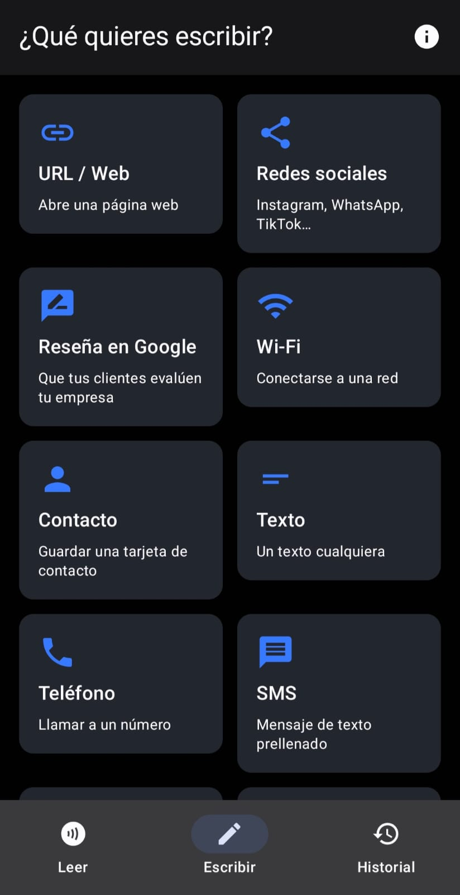

<div align="center">

# 📡 Gestor NFC

**Lee, escribe, protege y automatiza tags NFC desde tu teléfono Android.**


Hecho en Chillán, Chile 🇨🇱 por [Cristian Machuca](https://github.com/machukeitor1)

<br>



<sub><b>Escribir</b> · elige qué grabar en el tag</sub>

</div>

---

## Contenido

- [Funciones](#-funciones)
- [Chips compatibles](#-chips-compatibles)
- [Privacidad y permisos](#-privacidad-y-permisos)
- [Cómo compilar](#-cómo-compilar)
- [Pruebas](#-pruebas)
- [Estructura del proyecto](#-estructura-del-proyecto)

---

## ✨ Funciones

### 🔍 Leer
Información detallada del tag, al estilo de *NXP TagInfo*:

- Chip exacto (NTAG213/215/216, Ultralight EV1, MIFARE Classic…), UID y fabricante.
- **Firma de originalidad NXP**: comprueba si el chip es original o un clon.
- Contenido NDEF interpretado (URL, Wi‑Fi, contacto, texto, automatización…).
- Estado de bloqueo y contraseña, y volcado de memoria página por página.
- Copiar el contenido a otro tag o guardarlo como plantilla.

### ✏️ Escribir

| Tipo | Detalle |
|---|---|
| 🔗 URL | Cualquier enlace web |
| 💬 Redes sociales | 15 redes: Instagram, WhatsApp, TikTok, LinkedIn, YouTube, Spotify… (acepta `@usuario` o la URL completa) |
| 📶 Wi‑Fi | El teléfono ofrece conectarse a la red (Android e iPhone) |
| 👤 Contacto | Tarjeta vCard |
| ⭐ Reseña en Google | Abre directo el formulario para evaluar tu empresa (enlace del perfil o Place ID) |
| 📍 Ubicación | Google Maps o `geo:`; se pueden pegar enlaces de Maps |
| 📞 Teléfono · ✉️ SMS · 📧 Email | Con mensaje o asunto opcional |
| 📝 Texto | Texto libre |
| 📱 Abrir app | Android Application Record (AAR) |

Antes de escribir, la app muestra **cuánto ocupa el contenido** y si cabe en cada modelo de NTAG.

### ⚡ Automatizaciones
Tags que, al acercarlos al teléfono (incluso con la app cerrada), ejecutan acciones:

> 🔦 linterna · 🔔 modo de sonido · 🔊 volumen · ☀️ brillo · ⏱️ temporizador · 📱 abrir app o enlace · 📶 panel de Wi‑Fi · 🅱️ ajustes de Bluetooth

### 🔒 Proteger
- **Contraseña de escritura** (poner, cambiar o quitar) en NTAG21x y Ultralight EV1.
- Al escribir un tag protegido, la app pide la contraseña y puede **recordarla para ese tag** (por UID).
- **Bloqueo permanente** (solo lectura), con doble confirmación.

### 📋 Plantillas e historial
- Guarda cualquier contenido como plantilla y escríbelo una vez o **en serie** (muchos tags seguidos, protegiendo cada uno con contraseña si quieres).
- Historial de lecturas, escrituras y protecciones, con nombre y nota por tag, búsqueda y filtros.
- **Borrar / formatear**: deja el tag vacío (y formatea los tags nuevos).

### 🌎 Idiomas
Español, inglés y portugués según el idioma del teléfono (cualquier otro idioma usa inglés).
En Android 13+ se puede elegir el idioma solo para la app en *Ajustes → Apps → Gestor NFC → Idioma*.

---

## 🏷️ Chips compatibles

| Chip | Leer | Escribir | Contraseña | Firma NXP |
|---|:-:|:-:|:-:|:-:|
| NTAG213 / 215 / 216 | ✅ | ✅ | ✅ | ✅ |
| NTAG210 / 212 | ✅ | ✅ | ✅ | ✅ |
| MIFARE Ultralight EV1 | ✅ | ✅ | ✅ | ✅ |
| MIFARE Ultralight / Ultralight C | ✅ | ✅ | — | — |
| MIFARE Classic | ✅ ¹ | ✅ ¹ | — | — |
| ISO 14443‑4, ISO 15693, FeliCa | ✅ | Si es NDEF | — | — |

¹ Solo en teléfonos con chip NFC de NXP.

---

## 🛡️ Privacidad y permisos

La app **no pide acceso a internet**. El historial, las plantillas y las contraseñas recordadas se guardan solo en el almacenamiento privado del teléfono.

| Permiso | Para qué |
|---|---|
| NFC | Leer y escribir tags |
| Vibración | Avisar cuando se detecta un tag |
| No molestar | Automatizaciones de sonido y volumen |
| Modificar ajustes del sistema | Automatización de brillo |
| Alarmas | Automatización de temporizador |

Los permisos de las automatizaciones se piden solo cuando se usan.

---

## 🛠️ Cómo compilar

**Requisitos:** Android Studio (reciente), JDK 17 y un teléfono Android 8.0+ con NFC.

1. En Android Studio: *Open* → esta carpeta.
2. Espera a que termine el *Gradle sync*.
3. Conecta el teléfono (con depuración USB activada) y presiona ▶ *Run*.

> [!NOTE]
> El emulador de Android no tiene NFC: hay que probar en un teléfono real.

---

## 🧪 Pruebas

La lógica que no necesita un tag físico tiene **78 pruebas unitarias**: mapas de memoria NTAG, formato TLV, curva de la firma NXP, Wi‑Fi, vCard, redes sociales, coordenadas, contraseñas, automatizaciones e idiomas.

```bash
./gradlew test          # macOS / Linux
gradlew.bat test        # Windows
```

---

## 📂 Estructura del proyecto

```
app/src/main/java/cl/machukeitor/gestornfc/
├─ MainActivity.kt          modo lector NFC (enableReaderMode) y splash
├─ AutomationActivity.kt    ejecuta automatizaciones con la app cerrada
├─ NfcViewModel.kt          estado y trabajos sobre el tag (escribir, proteger, en serie)
├─ data/Stores.kt           historial y plantillas (JSON en almacenamiento privado)
├─ i18n/Tr.kt               textos en español, inglés y portugués
├─ nfc/
│  ├─ TagInspector.kt       lectura detallada (GET_VERSION, READ_SIG, READ…)
│  ├─ Ntag.kt               contraseña (PWD_AUTH) y escritura en tags protegidos
│  ├─ NxpSignature.kt       verificación ECDSA secp128r1 de la firma NXP
│  ├─ NdefParser.kt         interpreta registros NDEF
│  ├─ WritePayload.kt       tipos de contenido → NdefMessage
│  ├─ WifiConfig.kt         registro Wi‑Fi (WSC)
│  ├─ SocialNetwork.kt      redes sociales y armado de URLs
│  ├─ Automation.kt         acciones de automatización (JSON compacto)
│  ├─ AutomationRunner.kt   ejecuta las acciones en el teléfono
│  ├─ Coordinates.kt        coordenadas desde enlaces de Google Maps
│  ├─ PasswordStore.kt      contraseñas recordadas por UID
│  └─ TagWriter.kt          escritura NDEF y bloqueo permanente
└─ ui/                      pantallas Compose (Leer, Escribir, Proteger, Historial, Acerca de…)
```

---

<div align="center">

Hecho con ☕ en Chillán, Chile · [github.com/machukeitor1](https://github.com/machukeitor1)

</div>
